# Scanner Support Roadmap (`Broiler.Input.Scanner`)

- **Status:** Implemented — Phases S0–S6 completed; physical hardware validation tracked in [`docs/hardware-validation.md`](hardware-validation.md)
- **Scope:** Platform-neutral document/image scanner acquisition contracts (`Broiler.Input.Scanner`), platform providers (`Broiler.Input.Scanner.Windows`, `Broiler.Input.Scanner.Linux`, `Broiler.Input.Scanner.Android`), native bindings in `Broiler.Native`, deterministic fakes in `Broiler.Input.Testing`, and contract/hardware validation
- **Primary owner:** `Broiler.Input`
- **Contributing owners:** `Broiler.Native` (WIA 2.0 and SANE interop declarations), `Broiler.Media` / `Broiler.Documents` / `Broiler.Plate` (downstream image decoding, multi-page PDF assembly, OCR, and preview UI outside `Broiler.Input`)

---

## 1. Scope & Architectural Boundaries

Per [ADR 0001](adr/0001-assembly-names-repository-topology.md), [ADR 0002](adr/0002-abstract-device-hierarchy.md), [ADR 0004](adr/0004-event-and-stream-delivery.md), [ADR 0005](adr/0005-buffer-ownership.md), and [ADR 0008](adr/0008-media-interop-boundary.md), `Broiler.Input` owns live device discovery, capabilities, session lifecycle, monotonic timestamps, bounded delivery, disposable buffer leases, and fault/availability classification.

### What `Broiler.Input.Scanner` Owns
1. **Flatbed, Sheetfed, and ADF (Simplex/Duplex) Document & Image Scanners:**
   - Device discovery, hot-plug/availability watching, and opaque stable Broiler device IDs.
   - Querying physical scanner capabilities: supported paper sources (`Flatbed`, `FeederSimplex`, `FeederDuplex`, `Auto`), optical DPI ranges/discrete steps, supported pixel/color formats (`BlackAndWhite1Bit`, `Grayscale8`, `Grayscale16`, `Rgb24`, `Bgra32`, `Rgba32`), physical bed/feeder dimensions, and basic hardware acquisition controls (brightness, contrast, threshold, lamp/warmup state).
   - Executing single-page, multi-page batch (ADF), and low-DPI prescan/preview acquisition sessions with bounded delivery of owned, disposable `ScannerPageLease` (and optional progressive `ScannerBandLease`) buffers.
   - Translating hardware/driver conditions into `InputErrorCategory` and scanner-specific fault diagnostics (paper jam, feeder empty, cover open, lamp warming, device busy, permission denied, device removed).

### What Stays Outside `Broiler.Input.Scanner`
- **Document & Image Codecs / Containers:** PDF generation (`Broiler.Documents.Pdf`), TIFF/PNG/JPEG file encoding (`Broiler.Media.Image.Managed`), and multi-page document model construction (`Broiler.Graphics.Paging` / `Broiler.Documents`) remain in their owning components. When a native driver transfers compressed container streams (e.g., WIA file/memory BMP/PNG/JPEG transfers), the Windows/Linux scanner provider normalizes uncompressed raster pixel planes or exposes raw transfer format metadata without taking a dependency on `Broiler.Graphics` or `Broiler.Documents`.
- **OCR, Barcode Decoding, and Image Processing:** Deskewing, auto-crop detection, optical character recognition (OCR), and 1D/2D barcode/QR decoding from images belong in `Broiler.Media` or application layers (`Broiler.Plate`, `Broiler.Writer`, `Broiler.Browser`).
- **HID Barcode Scanners:**
  - *Keyboard-wedge barcode scanners* already surface through `Broiler.Input.Keyboard` (`WindowsKeyboardProvider` / `LinuxKeyboardProvider`) and require no scanner-specific provider.
  - *Camera-based barcode scanning* consumes `CameraInputDevice.FrameReady` from `Broiler.Input.Camera` directly.
  - *Dedicated USB HID POS Barcode Scanners (HID Usage Page `0x8C`)* are discrete symbol-event devices, not 2D raster page scanners; if needed in the future, they will be evaluated as a separate HID symbol contract rather than conflated with 2D page/image acquisition.

---

## 2. Camera Reuse Analysis: What Can Be Reused vs. What Must Differ

A central design question is how much of `Broiler.Input.Camera` and `Broiler.Input.Camera.Windows` can be reused for Scanner support.

### 2.1 Why Scanner Must Not Subclass or Reference `Broiler.Input.Camera`
- **ADR 0001 & ADR 0002 Isolation Rule:** Every device kind has one direct abstract base class under `InputDevice` (`ScannerInputDevice : InputDevice` in `Broiler.Input.Scanner`) and must not reference sibling device assemblies (`Broiler.Input.Camera`, `Broiler.Input.Microphone`, etc.). Contract tests (`Program.ContractTests.cs`) explicitly enforce that device assemblies only reference `Broiler.Input`.
- **Stream vs. Job/Batch Acquisition Semantics:**
  - `CameraInputDevice` models an unbounded real-time video stream parameterized by frame rate (`FrameRateNumerator`/`FrameRateDenominator`) where dropping older frames (`KeepLatest` / `CameraLatestFramePreviewAdapter`) is the default.
  - `ScannerInputDevice` models a **finite, job-driven acquisition session** (one flatbed page or an $N$-page ADF batch) parameterized by **spatial resolution (`DpiX`, `DpiY`)**, **physical crop geometry (`ScannerRegion` in microns/mils)**, and **paper source (`Flatbed`, `FeederSimplex`, `FeederDuplex`)**. Dropping a scanned page in an ADF batch is a data-loss error unless explicitly running a replaceable prescan preview.

### 2.2 Direct Code & Infrastructure Reuse (No Duplication)

```mermaid
flowchart TD
    subgraph Core["Broiler.Input (Directly Reused)"]
        ID["InputDevice / InputKind"]
        IP["IInputProvider / IInputDeviceWatcher"]
        IDO["InputDeliveryOptions / InputDeliveryMetrics"]
        IF["InputFault / InputErrorCategory / IInputClock"]
    end

    subgraph WinShared["Broiler.Input.Windows (Directly Reused)"]
        WCW["WindowsCaptureWorker&lt;TLease&gt;"]
        WIC["WindowsInputClock"]
        WCI["WindowsComInterop / ComThreadScope (Extracted from Camera.Windows)"]
    end

    subgraph LinuxShared["Broiler.Input.Linux (Directly Reused)"]
        LNP["LinuxInputNativeLibraryProbe"]
        LRL["LinuxReadLoopSession"]
    end

    subgraph Camera["Broiler.Input.Camera(.Windows)"]
        CD["CameraInputDevice"]
        CFL["CameraFrameLease / CameraFramePlane"]
        WCS["WindowsCameraCaptureSession"]
    end

    subgraph Scanner["Broiler.Input.Scanner(.Windows / .Linux)"]
        SD["ScannerInputDevice"]
        SPL["ScannerPageLease / ScannerImagePlane"]
        WSS["WindowsScannerCaptureSession (WIA 2.0)"]
        LSS["LinuxScannerCaptureSession (SANE)"]
    end

    ID --> CD
    ID --> SD
    WCW --> WCS
    WCW --> WSS
    WCI --> WCS
    WCI --> WSS
    LNP --> LSS
    LRL --> LSS
```

| Layer / Component | Camera Implementation | Reuse Strategy for Scanner |
| --- | --- | --- |
| **Root Device Lifecycle** (`Broiler.Input`) | [`InputDevice`](../src/Broiler.Input/InputDevice.cs), `InputDeviceDescriptor`, `InputDeviceId`, `InputCapability`, `InputDeviceState` | **Reuse 100% as-is.** Add `InputKind.Scanner` to [`InputKind`](../src/Broiler.Input/InputKind.cs). `ScannerInputDevice` inherits directly from `InputDevice`. |
| **Provider & Discovery** (`Broiler.Input`) | [`IInputProvider<TDevice, TOptions>`](../src/Broiler.Input/IInputProvider.cs), [`IInputDeviceWatcher`](../src/Broiler.Input/IInputDeviceWatcher.cs), `InputDeviceChange` | **Reuse 100% as-is.** `IScannerInputProvider : IInputProvider<ScannerInputDevice, ScannerOpenOptions>`. |
| **Bounded Delivery & Metrics** (`Broiler.Input`) | [`InputDeliveryOptions`](../src/Broiler.Input/InputDeliveryOptions.cs), `InputDeliveryOverflowPolicy`, `InputDeliveryMetrics` | **Reuse 100% as-is.** Default scanner sessions use `LossSensitive` (`DropNewest` or `Fail` with bounded page queue capacity, e.g., `Capacity = 8`), whereas prescan/preview can use `KeepLatest` (`Capacity = 1`). |
| **Windows Background Capture & Delivery Worker** (`Broiler.Input.Windows`) | [`WindowsCaptureWorker<T>`](../src/Broiler.Input.Windows/WindowsCaptureWorker.cs) | **Reuse 100% as-is.** `WindowsCaptureWorker<T>` is already generic (`where T : class, IDisposable`) and handles capture/delivery thread separation, queue overflow policies, callback exception isolation, startup cancellation, and deadlock-free `StopAsync`/`Dispose` from inside callbacks. Expose to `Broiler.Input.Scanner.Windows` via `[InternalsVisibleTo]` in [`Broiler.Input.Windows/AssemblyInfo.cs`](../src/Broiler.Input.Windows/AssemblyInfo.cs). |
| **Windows COM Lifetime & Pointer Wrapping** (`Broiler.Input.Camera.Windows` → `Broiler.Input.Windows`) | [`WindowsComInterop`](../src/Broiler.Input.Camera.Windows/WindowsMediaFoundationLifetime.cs) & COM `CoInitializeEx` scope | **Extract & share in `Broiler.Input.Windows`.** `WindowsComInterop.Wrap<TInterface>` and `Release` in `WindowsMediaFoundationLifetime.cs` only depend on `Broiler.Native.Windows.ComNative`. Moving `WindowsComInterop` and a reusable `WindowsComApartmentScope` into `Broiler.Input.Windows` lets both `Camera.Windows` (Media Foundation) and `Scanner.Windows` (WIA 2.0 COM) share it directly. |
| **Device ID Hashing & Native Capability Isolation** (`Broiler.Input.Camera.Windows`) | [`WindowsCameraDeviceEnumerator.ToStableInputId`](../src/Broiler.Input.Camera.Windows/WindowsCameraDeviceEnumerator.cs) | **Reuse pattern (or share helper in `Broiler.Input.Windows`).** Hash native WIA device IDs (`IWiaPropertyStorage` `WIA_DIP_DEV_ID`) with SHA-256 into `windows:wia:scanner:<24-hex>` and keep the raw WIA device ID in an `InputCapability("windows.wia.device-id", ...)` entry. |
| **Disposable Frame/Page Memory Lease** (`Broiler.Input.Camera`) | [`CameraFrameLease`](../src/Broiler.Input.Camera/CameraFrameLease.cs), [`CameraFramePlane`](../src/Broiler.Input.Camera/CameraFramePlane.cs), [`CameraPixelFormat`](../src/Broiler.Input.Camera/CameraPixelFormat.cs), [`CameraRotation`](../src/Broiler.Input.Camera/CameraRotation.cs), [`CameraColorSpace`](../src/Broiler.Input.Camera/CameraColorSpace.cs) | **Mirror structural design in `Broiler.Input.Scanner`.** `ScannerPageLease` owns the copied `byte[]` buffer, `IReadOnlyList<ScannerImagePlane>` (offset, length, stride, width, height), `ScannerFormat`, `ScannerRotation`, `ScannerColorSpace`, plus scanner-specific metadata (`PageNumber`, `ScannerSheetSide`, `ActualDpiX`, `ActualDpiY`, `ScannerPageFlags`). Disposing invalidates `Memory` with `ObjectDisposedException`. |
| **Latest-Frame Preview Adapter** (`Broiler.Input.Camera`) | [`CameraLatestFramePreviewAdapter`](../src/Broiler.Input.Camera/CameraLatestFramePreviewAdapter.cs) | **Mirror as `ScannerPreviewAdapter` in `Broiler.Input.Scanner`.** Retains the latest prescan/preview `ScannerPageLease` with thread-safe disposal race protection (verified by `PreviewDisposalRace` regression test). |
| **Linux Native Probing & Read Loop** (`Broiler.Input.Linux`) | [`LinuxInputNativeLibraryProbe`](../src/Broiler.Input.Linux/LinuxNativeLibraryProbe.cs), [`LinuxReadLoopSession`](../src/Broiler.Input.Linux/LinuxReadLoopSession.cs) | **Reuse directly.** Add a `LinuxInputNativeLibraryRequirement` for `libsane.so.1` / `libsane.so` and use `LinuxReadLoopSession` (or a Linux capture worker equivalent) to run non-blocking/cancellable `sane_start` / `sane_read` loops. |
| **Camera-as-Scanner (Webcam Document/Barcode Capture)** | `Broiler.Input.Camera` (`CameraInputDevice`) | **Reuse directly above `Broiler.Input`.** Applications wishing to scan documents or barcodes using a camera use `Broiler.Input.Camera` as-is (`CameraSessionOptions.LossSensitiveDefault` for still capture or `PreviewDefault` for live viewfinder) and feed `CameraFrameLease.Memory` into `Broiler.Media` / `Broiler.Documents`. |

---

## 3. Target Package & Assembly Topology

Following [ADR 0001](adr/0001-assembly-names-repository-topology.md) and the dependency rules in [README.md](../README.md):

| Package / Assembly | Target Framework | Dependencies | Role |
| --- | --- | --- | --- |
| `Broiler.Input.Scanner` | `net10.0` | `Broiler.Input` | Platform-neutral scanner contracts, capabilities, options, page leases, and state events |
| `Broiler.Input.Scanner.Windows` | `net10.0-windows` (or `net10.0` with `[SupportedOSPlatform("windows")]` matching `Camera.Windows`) | `Broiler.Input.Scanner`, `Broiler.Input.Windows`, `Broiler.Native.Windows` | Windows Image Acquisition (WIA 2.0) scanner provider |
| `Broiler.Input.Scanner.Linux` | `net10.0` | `Broiler.Input.Scanner`, `Broiler.Input.Linux`, `Broiler.Native.Linux` | Linux SANE (`libsane`) scanner provider |
| `Broiler.Input.Scanner.Android` | `net10.0` | `Broiler.Input.Scanner`, `Broiler.Input.Android` | Host-driven Android page/scan translation provider (no `Mono.Android` SDK dependency) |

Additionally:
- `Broiler.Input.All` (`src/Broiler.Input.All/Broiler.Input.All.csproj`) will reference `Broiler.Input.Scanner`.
- `Broiler.Input.Testing` will add `FakeScannerProvider` and `FakeScannerInputDevice`.

---

## 4. Detailed Phase-by-Phase Roadmap

### Phase S0 — Core Enum, Shared Windows COM Helpers, and ADR Update (Completed)

1. **`Broiler.Input` Core Updates:**
   - Add `Scanner` to [`InputKind`](../src/Broiler.Input/InputKind.cs).
   - Evaluate whether [`InputErrorCategory`](../src/Broiler.Input/InputErrorCategory.cs) needs a media/physical intervention category (e.g., `MediaInterventionRequired` for paper jam / feeder empty / cover open) or if scanner-specific detail belongs on `ScannerFaultReason` alongside existing `InputErrorCategory` values (`DeviceBusy`, `DeviceRemoved`, `PermissionDenied`, `UnsupportedCapability`, `NativeFailure`, `CaptureDiscontinuity`). Keeping `InputErrorCategory` stable and adding a typed `ScannerFaultCode` on `ScannerCaptureStateChangedEvent` / `InputDiagnosticEvent` properties avoids breaking existing `InputErrorCategory` switch consumers.
2. **Extract Shared COM Helpers in `Broiler.Input.Windows`:**
   - Move `WindowsComInterop` (`Wrap<TInterface>`, `Release`) and a general `WindowsComApartmentScope` out of [`WindowsMediaFoundationLifetime.cs`](../src/Broiler.Input.Camera.Windows/WindowsMediaFoundationLifetime.cs) into `Broiler.Input.Windows` so `Camera.Windows`, `Microphone.Windows`, and `Scanner.Windows` share one implementation.
   - Add `[assembly: InternalsVisibleTo("Broiler.Input.Scanner.Windows")]` to [`Broiler.Input.Windows/AssemblyInfo.cs`](../src/Broiler.Input.Windows/AssemblyInfo.cs).
3. **Documentation & ADR Alignment:**
   - Record an ADR (`docs/adr/0009-scanner-acquisition-boundary.md`) documenting the job/page-based acquisition model, WIA/SANE native boundary, and raw-bitmap vs. compressed-transfer normalization rule.

**Exit Gate:** `dotnet build Broiler.Input.slnx -c Release` and `Broiler.Input.Contract.Tests` pass with zero regressions.

---

### Phase S1 — Platform-Neutral Contracts (`Broiler.Input.Scanner`) (Completed)

Create `src/Broiler.Input.Scanner/Broiler.Input.Scanner.csproj` (`net10.0`, referencing only `Broiler.Input`) with the following public types:

1. **Provider & Device Base:**
   - `IScannerInputProvider : IInputProvider<ScannerInputDevice, ScannerOpenOptions>`
   - `ScannerInputDevice : InputDevice` (requires `descriptor.Kind == InputKind.Scanner`):
     - `event Action<ScannerPageReadyEvent>? PageReady`
     - `event Action<ScannerCaptureStateChangedEvent>? CaptureStateChanged`
     - `event Action<ScannerProgressEvent>? ProgressChanged` (optional band/percentage progress for slow high-DPI scans)
     - `ScannerCaptureState CaptureState { get; }`
     - `ScannerCaptureStatistics CaptureStatistics { get; }`
     - `ScannerFormat? NegotiatedFormat { get; }`
     - `ScannerCapabilities? DeviceCapabilities { get; }`
2. **Capabilities & Formats:**
   - `ScannerSourceKind`: `Unknown = 0`, `Flatbed`, `FeederSimplex`, `FeederDuplex`, `Auto`
   - `ScannerPixelFormat`: `Unknown = 0`, `BlackAndWhite1Bit`, `Grayscale8`, `Grayscale16`, `Rgb24`, `Bgra32`, `Rgba32`
   - `ScannerColorSpace`: `Unknown = 0`, `SRgb`, `LinearGray`
   - `ScannerRotation`: `None = 0`, `Rotate90 = 90`, `Rotate180 = 180`, `Rotate270 = 270`
   - `ScannerRegion`: physical scan area (`OffsetXMicrons`, `OffsetYMicrons`, `WidthMicrons`, `HeightMicrons`) with helper conversions for inches/millimeters/points (`BPaperSize` compatible dimensions without referencing `Broiler.Graphics`).
   - `ScannerFormat`: `(ScannerSourceKind Source, int DpiX, int DpiY, ScannerPixelFormat PixelFormat, ScannerRegion? Region = null)`
   - `ScannerCapability`: supported sources, min/max/step DPI, max bed/feeder dimensions in microns, supported `ScannerPixelFormat` values, duplex support flag.
3. **Options & Session Lifecycle:**
   - `ScannerOpenOptions`: `(ScannerFormat? PreferredFormat = null, ScannerSessionOptions? SessionOptions = null)`
   - `ScannerSessionOptions`:
     - `InputDeliveryOptions DeliveryOptions` (defaults to `Capacity = 8, OverflowPolicy = DropNewest` or `Fail` in `LossSensitive` mode; `Capacity = 1, KeepLatest` in `Preview` mode)
     - `ScannerDeliveryMode DeliveryMode` (`LossSensitiveBatch = 0`, `LatestPagePreview = 1`)
     - `int MaxPages` (`0` = all pages in feeder or `1` for flatbed)
     - `double Brightness` / `double Contrast` (normalized `-1.0` to `1.0`, `0.0` default)
   - `ScannerCaptureState`: `Stopped = 0`, `Starting`, `WarmingUp`, `Scanning`, `Stopping`, `Completed`, `Faulted`, `Invalidated`
   - `ScannerFaultCode`: `None = 0`, `PaperJam`, `FeederEmpty`, `CoverOpen`, `LampFailure`, `MultiFeedDetected`, `TransferAborted`
4. **Lease & Event Payloads:**
   - `ScannerImagePlane(int Offset, int Length, int Stride, int Width, int Height)`
   - `ScannerPageFlags`: `None = 0`, `Preview = 1 << 0`, `DuplexBackSide = 1 << 1`, `EndOfBatch = 1 << 2`, `FormatChanged = 1 << 3`, `TimestampError = 1 << 4`
   - `ScannerPageLease : IDisposable`:
     - `ReadOnlyMemory<byte> Memory` (throws `ObjectDisposedException` after `Dispose()`)
     - `ScannerFormat Format`
     - `IReadOnlyList<ScannerImagePlane> Planes`
     - `InputTimestamp Timestamp`
     - `long PageNumber` (0-based within the scan session)
     - `int Width` / `int Height` (in pixels)
     - `ScannerPageFlags Flags`
     - `ScannerRotation Rotation`
     - `ScannerColorSpace ColorSpace`
   - `ScannerPageReadyEvent(InputEventHeader Header, ScannerPageLease Page)`
   - `ScannerCaptureStatistics(long PagesCapturedCount, long PagesDeliveredCount, long PagesDroppedNewestCount, long PagesDroppedOldestCount, long BytesTransferred, int QueueDepth)`
   - `ScannerPreviewAdapter : IDisposable` (mirrors `CameraLatestFramePreviewAdapter` for prescan UI polling).

**Exit Gate:** Deterministic unit tests in `Broiler.Input.Testing` (`FakeScannerProvider`, `FakeScannerInputDevice`) and `Broiler.Input.Contract.Tests` verify lifecycle, multi-page ADF batch completion (`EndOfBatch`), duplex front/back page flags, bounded delivery, lease disposal invalidation, and `api-baseline.txt` parity.

---

### Phase S2 — Native Interop Declarations in `Broiler.Native` (Completed)

Per the native boundary rules in [README.md](../README.md) and [packaging.md](packaging.md), all COM/PInvoke definitions live in `Broiler.Native`:

1. **`Broiler.Native.Windows` (`src/Broiler.Native.Windows/Wia/WindowsWiaNative.cs`):**
   - COM CLSIDs and IIDs for WIA 2.0 (`CLSID_WiaDevMgr2` `B6C292BC-7C88-41EE-8B54-8EC92617E599`, `IID_IWiaDevMgr2`, `IID_IEnumWIA_DEV_INFO`, `IID_IWiaPropertyStorage`, `IID_IWiaItem2`, `IID_IEnumWiaItem2`, `IID_IWiaTransfer`, `IID_IWiaTransferCallback`).
   - WIA 2.0 property constants:
     - Device info: `WIA_DIP_DEV_ID`, `WIA_DIP_DEV_NAME`, `WIA_DIP_DEV_TYPE`, `WIA_DIP_VEND_DESC`, `WIA_DIP_UI_CLSID`.
     - Scanner item/device properties: `WIA_DPS_DOCUMENT_HANDLING_CAPABILITIES`, `WIA_DPS_DOCUMENT_HANDLING_SELECT` (`FLATBED`, `FEEDER`, `DUPLEX`), `WIA_DPS_DOCUMENT_HANDLING_STATUS`, `WIA_DPS_PAGES`, `WIA_DPS_HORIZONTAL_BED_SIZE`, `WIA_DPS_VERTICAL_BED_SIZE`, `WIA_DPS_SHEET_FEEDER_REGISTRATION`.
     - Image item properties: `WIA_IPA_DATATYPE` (`WIA_DATA_THRESHOLD`, `WIA_DATA_GRAYSCALE`, `WIA_DATA_COLOR`), `WIA_IPA_DEPTH`, `WIA_IPS_XRES`, `WIA_IPS_YRES`, `WIA_IPS_XPOS`, `WIA_IPS_YPOS`, `WIA_IPS_XEXTENT`, `WIA_IPS_YEXTENT`, `WIA_IPS_BRIGHTNESS`, `WIA_IPS_CONTRAST`, `WIA_IPA_FORMAT` (`WiaImgFmt_MEMORYBMP`, `WiaImgFmt_BMP`, `WiaImgFmt_RAW`), `WIA_IPA_PIXELS_PER_LINE`, `WIA_IPA_BYTES_PER_LINE`, `WIA_IPA_NUMBER_OF_LINES`.
   - WIA HRESULT error constants: `WIA_ERROR_GENERAL_ERROR`, `WIA_ERROR_PAPER_JAM`, `WIA_ERROR_PAPER_EMPTY`, `WIA_ERROR_PAPER_PROBLEM`, `WIA_ERROR_OFFLINE`, `WIA_ERROR_BUSY`, `WIA_ERROR_WARMING_UP`, `WIA_ERROR_USER_INTERVENTION`, `WIA_ERROR_ITEM_DELETED`, `WIA_ERROR_DEVICE_COMMUNICATION`, `WIA_ERROR_INVALID_COMMAND`, `WIA_ERROR_INCORRECT_HARDWARE_setting`, `WIA_ERROR_DEVICE_LOCKED`, `WIA_ERROR_COVER_OPEN`, `WIA_ERROR_LAMP_OFF`, `WIA_ERROR_MULTI_FEED`, `WIA_S_NO_DEVICE_AVAILABLE`.
   - Standard COM `IStream` vtable wrapper for `IWiaTransferCallback::GetNextStream` in-memory page reception without temporary files.
2. **`Broiler.Native.Linux` (`src/Broiler.Native.Linux/Scanner/LinuxSaneNative.cs`):**
   - `libsane.so.1` C ABI bindings (`sane_init`, `sane_exit`, `sane_get_devices`, `sane_open`, `sane_close`, `sane_get_option_descriptor`, `sane_control_option`, `sane_get_parameters`, `sane_start`, `sane_read`, `sane_cancel`, `sane_set_io_mode`, `sane_get_select_fd`, `sane_strstatus`).
   - Struct layouts (`SANE_Device`, `SANE_Option_Descriptor`, `SANE_Parameters`, `SANE_Range`) and `SANE_Status` / `SANE_Frame` / `SANE_Unit` / `SANE_Value_Type` enums with ABI size/alignment tests in `Broiler.Native.Tests`.

**Exit Gate:** `Broiler.Native` builds cleanly, passes ABI verification tests, and is published to NuGet.org before `Broiler.Input` bumps its `Broiler.Native.*` versions in `Directory.Packages.props`.

---

### Phase S3 — Windows WIA 2.0 Provider (`Broiler.Input.Scanner.Windows`) (Completed)

Implement `Broiler.Input.Scanner.Windows` mirroring the structure of `Broiler.Input.Camera.Windows`:

1. **`WindowsScannerProvider` & `WindowsScannerDeviceEnumerator`:**
   - Initialize COM via `WindowsComApartmentScope` and instantiate `IWiaDevMgr2` (`CLSID_WiaDevMgr2`).
   - Enumerate `StiDeviceTypeScanner` (`0x0001`) devices via `IWiaDevMgr2::EnumDeviceInfo(WIA_DEVINFO_ENUM_LOCAL)`.
   - Read `WIA_DIP_DEV_ID` and `WIA_DIP_DEV_NAME`; hash `WIA_DIP_DEV_ID` via SHA-256 into `windows:wia:scanner:<hash>` and attach `new InputCapability("windows.wia.device-id", wiaDeviceId)` and `new InputCapability("scanner.capture.source", "wia2")`.
   - Implement `IInputDeviceWatcher` (`RefreshDevicesAsync` diffing added/changed/removed descriptors, matching [`WindowsCameraProvider`](../src/Broiler.Input.Camera.Windows/WindowsCameraProvider.cs)).
2. **`WindowsScannerInputDevice` & `WindowsScannerCaptureSession`:**
   - Reuse [`WindowsCaptureWorker<ScannerPageLease>`](../src/Broiler.Input.Windows/WindowsCaptureWorker.cs) for background capture thread and decoupled delivery thread execution.
   - Negotiate `ScannerFormat` on the root and child `IWiaItem2` (`Flatbed`, `Feeder`, `Duplex` item selection via `WIA_DPS_DOCUMENT_HANDLING_SELECT`; set `WIA_IPS_XRES`, `WIA_IPS_YRES`, `WIA_IPA_DATATYPE`, `WIA_IPA_DEPTH`, `WIA_IPS_XPOS`/`YPOS`/`XEXTENT`/`YEXTENT` converted from microns to thousandths of an inch).
   - Request `WiaImgFmt_MEMORYBMP` (or `WiaImgFmt_RAW` where supported) on `IWiaTransfer::Download`, supplying a managed COM `IWiaTransferCallback` implementation that writes each transferred page into an in-memory buffer, normalizes bottom-up DIB rows/1-bit packed monochrome/BGR24 into top-down `ScannerImagePlane` layout, wraps it in a `ScannerPageLease`, and enqueues it into `WindowsCaptureWorker<ScannerPageLease>`.
   - Support multi-page ADF loops: continue acquiring pages until `WIA_ERROR_PAPER_EMPTY` (which marks `ScannerPageFlags.EndOfBatch` and transitions smoothly to `ScannerCaptureState.Completed` when at least one page was scanned, or `Faulted` with `ScannerFaultCode.FeederEmpty` if the feeder was empty at job start) or `MaxPages` is reached.
   - Implement `InterruptCapture` via `IWiaTransferCallback::TransferCallback` returning `S_FALSE` / cancelling the active transfer so `StopAsync` and `Dispose` return deterministically.
3. **`WindowsScannerFaults` (`InputScannerException`):**
   - Map WIA HRESULTs to `InputErrorCategory` and `ScannerFaultCode`:
     - `E_ACCESSDENIED` → `InputErrorCategory.PermissionDenied`
     - `WIA_S_NO_DEVICE_AVAILABLE`, `E_NOTFOUND` → `InputErrorCategory.DeviceNotFound`
     - `WIA_ERROR_OFFLINE`, `WIA_ERROR_ITEM_DELETED`, `WIA_ERROR_DEVICE_COMMUNICATION` → `InputErrorCategory.DeviceRemoved`
     - `WIA_ERROR_BUSY`, `WIA_ERROR_DEVICE_LOCKED` → `InputErrorCategory.DeviceBusy`
     - `WIA_ERROR_INVALID_COMMAND`, `WIA_ERROR_INCORRECT_HARDWARE_SETTING` → `InputErrorCategory.UnsupportedCapability`
     - `WIA_ERROR_PAPER_JAM` → `InputErrorCategory.CaptureDiscontinuity` + `ScannerFaultCode.PaperJam`
     - `WIA_ERROR_PAPER_EMPTY` → `InputErrorCategory.CaptureDiscontinuity` + `ScannerFaultCode.FeederEmpty`
     - `WIA_ERROR_COVER_OPEN` → `InputErrorCategory.CaptureDiscontinuity` + `ScannerFaultCode.CoverOpen`
     - `WIA_ERROR_MULTI_FEED` → `InputErrorCategory.CaptureDiscontinuity` + `ScannerFaultCode.MultiFeedDetected`

**Exit Gate:** Contract isolation tests verify `Broiler.Input.Scanner.Windows` has no references to `Broiler.Graphics`, UI frameworks, or third-party wrappers; synthetic/mock COM transfer tests verify single-page flatbed, multi-page ADF duplex, paper-jam fault handling, and callback-initiated `StopAsync`/`Dispose`.

---

### Phase S4 — Linux SANE Provider (`Broiler.Input.Scanner.Linux`) (Completed)

1. **Native Library Probe:**
   - Add `LinuxInputNativeLibraryProbe.Sane` (`["libsane.so.1", "libsane.so"]`, `Required: false`) in [`LinuxNativeLibraryProbe.cs`](../src/Broiler.Input.Linux/LinuxNativeLibraryProbe.cs).
2. **`LinuxScannerProvider` & `LinuxScannerInputDevice`:**
   - Enumerate devices via `sane_get_devices`, hashing `SANE_Device.name` into `linux:sane:scanner:<hash>` and storing the backend device name in an internal/Linux capability (`linux.sane.device-name`) so native device paths never leak into default diagnostics.
   - Map standard SANE well-known options (`source` → `Flatbed`/`ADF`/`Duplex`, `resolution` → `DpiX`/`DpiY`, `mode` → `Lineart`/`Gray`/`Color`, `tl-x`/`tl-y`/`br-x`/`br-y` → `ScannerRegion`).
   - Run acquisition loop on a background worker using `sane_start` and `sane_read` per page; call `sane_cancel` on interruption/stop.
   - Map `SANE_Status` (`SANE_STATUS_GOOD`, `SANE_STATUS_EOF`, `SANE_STATUS_NO_DOCS`, `SANE_STATUS_JAMMED`, `SANE_STATUS_COVER_OPEN`, `SANE_STATUS_DEVICE_BUSY`, `SANE_STATUS_ACCESS_DENIED`, `SANE_STATUS_INVAL`, `SANE_STATUS_IO_ERROR`) to the same neutral `InputErrorCategory` and `ScannerFaultCode` values as Windows.

**Exit Gate:** Linux unit tests in `Broiler.Input.Linux.Tests` verify option translation, multi-page `SANE_STATUS_NO_DOCS` batch termination, and `sane_cancel` teardown using a deterministic fake SANE interop table.

---

### Phase S5 — Android Host-Driven Scanner Provider (`Broiler.Input.Scanner.Android`) (Completed)

Following the architecture of `Broiler.Input.Android` (zero `Mono.Android` SDK references, primitive/byte-array forwarding from the host Activity):

1. **`AndroidScannerProvider` & `AndroidScannerInputDevice`:**
   - Extend `AndroidInputProvider<AndroidScannerInputDevice, ScannerOpenOptions>`.
   - Allow the Android host Activity (which invokes Android's `GmsDocumentScanner` / system document scan intent or network eSCL client) to push acquired page bitmaps/bytes, dimensions, DPI, and rotation into `AndroidScannerInputDevice.DeliverScannedPage(...)` and notify completion/cancellation via `IAndroidInputDevice`.
   - Enforce the boundary test in `Broiler.Input.Android.Tests` ensuring no `Mono.Android` or `Java.Interop` assembly references exist.

---

### Phase S6 — Packaging, API Baseline, and Hardware Validation (Completed)

1. **Solution & Packaging Updates:**
   - Add `Broiler.Input.Scanner`, `Broiler.Input.Scanner.Windows`, `Broiler.Input.Scanner.Linux`, and `Broiler.Input.Scanner.Android` to `Broiler.Input.slnx` and `Broiler.Input.All.csproj`.
   - Update [`docs/api-baseline.txt`](api-baseline.txt) with all exported types from `Broiler.Input.Scanner` and `Broiler.Input.Scanner.Windows`.
   - Verify `powershell -File eng/pack.ps1` and `powershell -File eng/verify-feed.ps1 -Packages artifacts` succeed for all shipping packages.
2. **Hardware Validation (`docs/hardware-validation.md`):**
   - Record opt-in physical hardware checks on Windows (USB/network WIA flatbed + ADF scanner) and Linux (`sane-airscan` / `sane-backends` test & physical scanner):
     - Stable opaque IDs across `RefreshDevicesAsync`.
     - Flatbed single-page scan at 150 DPI and 300 DPI (`Rgb24` and `Grayscale8`).
     - ADF multi-page simplex and duplex batch scan with clean completion on feeder empty.
     - Slow consumer backpressure and `StopAsync()` mid-scan cancelling physical carriage/transfer promptly and releasing the WIA/SANE device lock.
     - Diagnostics audit confirming no raw image bytes or unredacted native device paths are emitted by default.
